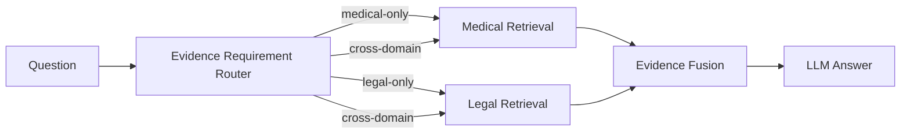

# Evidence-Aware Orthopedic Medical-Legal RAG

> Dual-domain RAG for orthopedic medical knowledge and healthcare regulations, with retrieval routing and evaluation.

这是一个面向骨科医疗—法规双领域问答的 RAG 原型。项目关注的核心问题不是“能不能检索到相似文本”，而是：

> 当一个问题同时需要临床证据与法规证据时，如何避免单一语料域在 Top-K 中占满结果，并减少不必要的跨域检索？

当前项目比较三种检索组织方式：**Single Pool、Fixed Dual、Routed Dual**，并用小规模 sanity set 观察领域覆盖、冗余召回和路由准确率。

## Why this project

传统 RAG 往往把不同来源的文本混在一个向量池里统一检索。

在医疗—法规混合场景里，这会带来两个问题：

- **领域竞争**：语料量更大的领域可能占满 Top-K，导致另一类必要证据缺失；
- **无关召回**：为保证覆盖而强制双域检索，又可能把不需要的领域内容一起召回。

这个项目尝试用“先判断需要什么证据，再决定检索路径”的方式缓解这两个问题。

## Retrieval modes

| Mode | Retrieval strategy |
|---|---|
| `ortho_single` | 医疗 + 法规混在一个池中，统一 Top-6 |
| `dual` | 医疗 Top-3 + 法规 Top-3，所有问题固定双域检索 |
| `routed` | 先判断证据需求，再选择 medical-only / legal-only / cross-domain |

Routed 模式支持三条路径：

- **medical-only** → medical Top-6
- **legal-only** → legal Top-6
- **cross-domain** → medical Top-3 + legal Top-3

## Architecture



## Preliminary evaluation

当前公开结果来自一个 **12 题 sanity set**：

- 4 个 medical-only
- 4 个 legal-only
- 4 个 cross-domain

| Metric | ortho_single | dual | routed |
|---|---:|---:|---:|
| Required Medical Coverage | 8/8 | 8/8 | 8/8 |
| Required Legal Coverage | 4/8 | 8/8 | 8/8 |
| Unnecessary Medical Retrieval | 4 | 12 | 3 |
| Unnecessary Legal Retrieval | 0 | 12 | 0 |
| Cross-domain Medical Avg | 6.0 | 3.0 | 3.0 |
| Cross-domain Legal Avg | 0.0 | 3.0 | 3.0 |
| Routing Exact Match | n/a | n/a | **11/12 (91.7%)** |

### Observations

- **Single Pool** 在 cross-domain 问题中出现医疗域完全占满 Top-6 的情况，法规证据缺失；
- **Fixed Dual** 能保证双域覆盖，但会给单域问题注入大量无关领域文本；
- **Routed Dual** 在当前 sanity set 上保留了双域覆盖，同时显著减少不必要召回。

> 这些结果只用于验证系统行为与实验方向。当前样本量很小，不主张统计显著性，也不将其视为生产级 benchmark。

## Tech stack

- Python
- FastAPI
- Streamlit
- Qdrant
- Ollama
- LangChain Ollama embeddings
- Docker / Docker Compose
- pytest

## Demo

- Streamlit UI: `src/app.py`
- FastAPI service: `src/api.py`
- Retrieval / routing core: `src/rag.py`
- Evaluation: `eval/run_eval.py` + `eval/analyze.py`

## Quick Start

### 1. Create an environment

```bash
uv venv .venv --python 3.11
```

Activate it with the command appropriate for your OS, then install dependencies:

```bash
uv pip install -r requirements.txt
```

### 2. Configure environment variables

```bash
cp .env.example .env
```

Default local configuration:

```env
QDRANT_URL=http://localhost:6333
OLLAMA_HOST=http://localhost:11434
OLLAMA_MODEL=llama3.1:8b
OLLAMA_EMBED_MODEL=nomic-embed-text
```

### 3. Prepare source documents locally

The public repository intentionally does **not** redistribute the source PDFs or derived text chunks.

Place documents you are permitted to use under:

```text
data/
├── medical_raw/
└── legal_raw/
```

Then run:

```bash
python src/prepare_medical_data.py
python src/prepare_legal_data.py
```

See `data/README.md` for the sources used in the current experiment and the public-repository data policy.

### 4. Start Qdrant / Ollama

```bash
docker compose up -d
```

If Ollama is already installed locally, you can start only Qdrant:

```bash
docker compose up -d qdrant
```

### 5. Build indices

```bash
python src/build_medical_index.py
python src/build_legal_index.py
python src/build_ortho_single_index.py
```

### 6. Health check

```bash
python src/demo_check.py
```

### 7. Start API / UI

```bash
uvicorn src.api:app --reload --port 8000
```

API docs:

```text
http://localhost:8000/docs
```

In another terminal:

```bash
streamlit run src/app.py
```

## Evaluation

The public repository includes the authored evaluation questions and the compact summary table, but not raw retrieval outputs containing source-document text.

```text
eval/
├── questions.csv
├── results_summary.csv
├── run_eval.py
└── analyze.py
```

Run locally after preparing the source corpora and indices:

```bash
python eval/run_eval.py
python eval/analyze.py
```

## Data sources

Current experiments use:

- **Medical**: AAOS, *Management of Hip Fractures in Older Adults* clinical practice guideline
- **Legal / regulatory**: CMS guidance related to surgical informed consent

Source documents and derived chunks are intentionally excluded from this public repository. Users should obtain source materials directly from the original publishers and follow their applicable terms.

## Limitations

- Evaluation currently uses only a 12-question sanity set;
- the medical and regulatory source scope is still narrow;
- routing has only been evaluated on this small authored set;
- there are no manual ground-truth chunk annotations yet, so Recall@K is not reported;
- answer-level factuality and citation correctness still need dedicated evaluation;
- the router currently depends on an LLM classification step and needs broader robustness testing.

## Next steps

- expand medical and regulatory source coverage;
- add manually annotated relevant chunks and Recall@K;
- add evidence-sufficiency checks;
- evaluate citation-level grounding and answer factuality;
- test routing on a larger and more diverse query set;
- compare deterministic / lightweight routing against LLM routing.

## Disclaimer

Research / coursework prototype only. **Not for clinical or legal use.**
